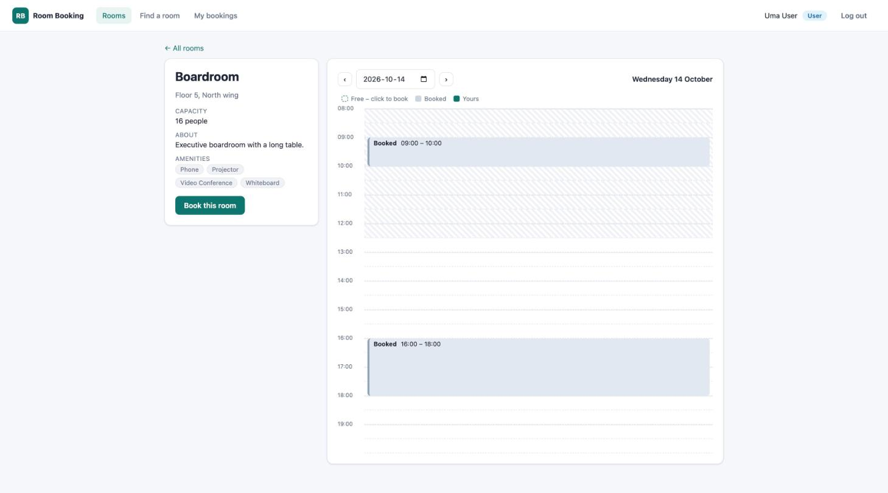
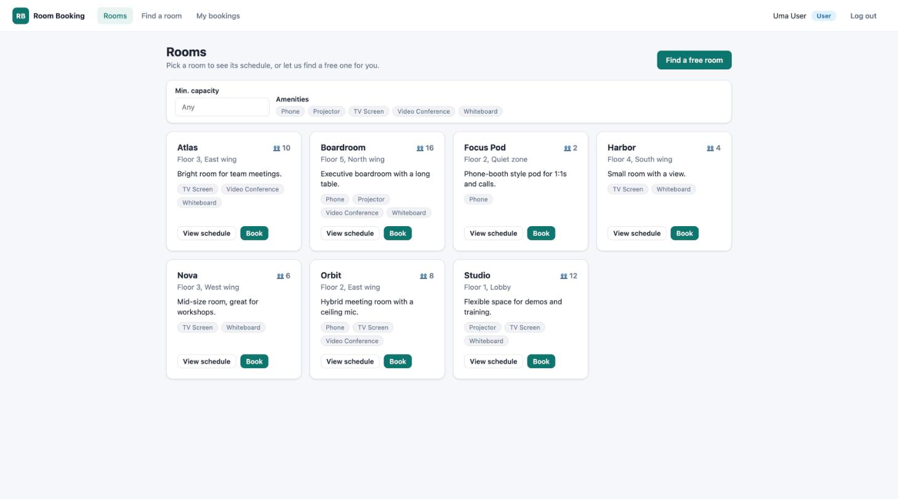
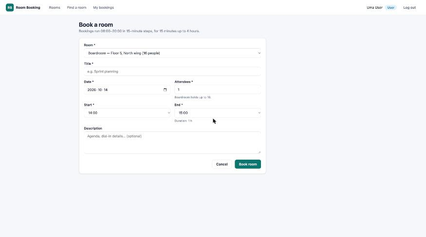
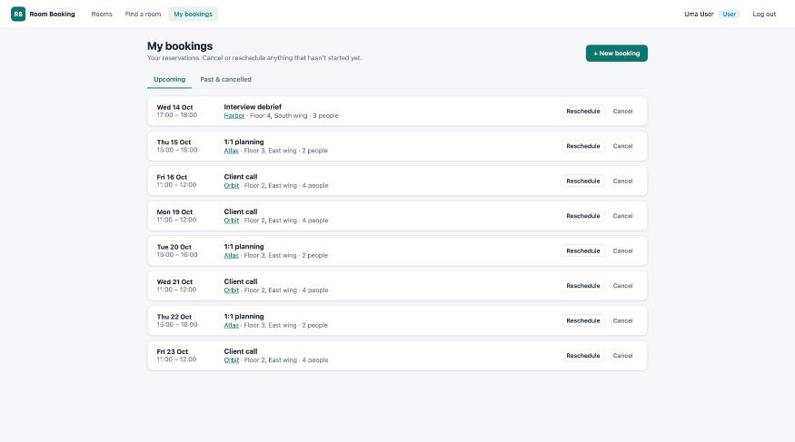

# Room Booking System

A full-stack **meeting room booking system** built with **Spring Boot 3 (Java 17)** and **Angular 17**.
Employees browse rooms, see each room's day on a visual timeline, find a free room for a time slot and
book it in two clicks; admins manage rooms, oversee every booking and watch utilization on a dashboard.
Under the hood it focuses on the hard part of any booking system - **never double-booking a room** -
with half-open interval overlap checks, a pessimistic row lock against race conditions, role-based
security with JWT, and 64 automated tests.

   

---

## Features

### Every user
- **Rooms** – card grid with capacity and amenity filters (Projector, Whiteboard, Video Conference, ...).
- **Room day timeline** – 08:00–20:00 in 30-minute rows, previous/next day navigation, booked blocks
  drawn to the minute; click any free row to open the booking form prefilled.
- **Find a room** – pick date, time and head-count, get only the rooms free for the *whole* slot, book one.
- **Booking form** – create or reschedule; friendly amber "that slot was just taken" panel on HTTP 409
  with shortcuts to alternatives.
- **My bookings** – Upcoming / Past & cancelled tabs, reschedule, cancel with inline confirmation.
- Privacy: other people's meetings show as "Booked" – only the owner and admins see titles.

### Admins
- **Dashboard** – bookings today / this week, cancellations, average utilization, busiest hour,
  Chart.js bar charts of utilization per room and bookings per hour.
- **Manage rooms** – create, edit, activate/deactivate (rooms with history are deactivated, never deleted).
- **All bookings** – filter by day, room and status, paged; cancel anyone's future booking.

### Business rules enforced by the API
End after start · same day · within 08:00–20:00 · 15-minute steps · 15 min to 4 h · not in the past ·
attendees ≤ capacity · room must be active · **no overlap with another confirmed booking in the room
(409)** · a user can't be in two meetings at once (409) · only owners (or admins) may change a booking,
and only before it starts.

## Tech stack

| Layer | Technology |
|---|---|
| Backend | Java 17, Spring Boot 3.5, Spring Web, Spring Data JPA (Hibernate 6), Bean Validation |
| Security | Spring Security 6, stateless JWT (jjwt 0.12), BCrypt, `@PreAuthorize` roles |
| Database | PostgreSQL 16 (prod) / H2 in PostgreSQL mode (dev & tests), Flyway migrations |
| API docs | springdoc-openapi (Swagger UI) |
| Frontend | Angular 17 (standalone components, signals, `@if`/`@for`), reactive forms, RxJS, Chart.js |
| Tests | JUnit 5, Mockito, AssertJ, MockMvc, Jasmine/Karma |
| Ops | Docker multi-stage builds, nginx, docker-compose, GitHub Actions CI |

## Quick start

### Option A – run locally (no database to install)

Requirements: Java 17, Node 18.

```bash
# Terminal 1 – API on http://localhost:8084 (in-memory H2, demo data seeded)
cd backend
./mvnw spring-boot:run

# Terminal 2 – Angular on http://localhost:4304 (proxies /api to :8084)
cd frontend
npm install
npm start
```

Open **http://localhost:4304**. Swagger UI: http://localhost:8084/swagger-ui.html.

> Always use the Maven wrapper (`./mvnw`), not a globally installed `mvn`.

### Option B – Docker (PostgreSQL + API + nginx)

```bash
docker compose up --build
```

Open **http://localhost:8094**.

## Demo credentials

| Role | Email | Password |
|---|---|---|
| Admin | `admin@example.com` | `password123` |
| User | `user@example.com` | `password123` |
| User | `alice@example.com`, `bob@example.com` | `password123` |

The login page has **"Use admin demo"** and **"Use user demo"** links.

## Screenshots



| Rooms | Booking form (prefilled from a timeline click) | My bookings |
|---|---|---|
|  |  |  |

## Running the tests

```bash
cd backend && ./mvnw -B verify          # 44 tests: unit (Mockito) + integration (MockMvc + H2)
cd frontend && npx ng test --watch=false --browsers=ChromeHeadless   # 20 specs
```

## Documentation

**[docs/HOW-IT-WORKS.md](docs/HOW-IT-WORKS.md)** – a detailed guide: architecture diagrams, the request
lifecycle of a booking, security and roles, data model, every business rule and the test that covers
it, overlap detection and concurrency deep-dive, full API reference, frontend timeline maths,
deployment, and interview talking points.

The code itself is heavily commented for learning purposes.

## Project structure

```
room-booking/
├── backend/                     Spring Boot REST API
│   ├── src/main/java/com/portfolio/roombooking/
│   │   ├── auth/                register / login / me
│   │   ├── user/                User entity, Role enum
│   │   ├── room/                rooms CRUD, availability, day schedule
│   │   ├── booking/             bookings, time rules, overlap queries, locking
│   │   ├── stats/               admin dashboard numbers
│   │   ├── security/            JWT service + filter, JSON 403 handler
│   │   ├── config/              Spring Security, Clock, OpenAPI, demo data
│   │   └── common/              ApiError, exceptions, global handler, PageResponse
│   ├── src/main/resources/      application.yml, application-prod.yml, Flyway SQL
│   └── src/test/java/...        unit + integration tests
├── frontend/                    Angular 17 SPA
│   └── src/app/
│       ├── core/                models, auth (service/interceptor/guards), API services
│       ├── shared/              time + timeline helpers, error messages, pipe
│       └── features/            auth, rooms, find-room, bookings, admin pages
├── docs/HOW-IT-WORKS.md         the in-depth guide
├── docker-compose.yml           Postgres + backend + frontend
└── .github/workflows/ci.yml     build & test on every push
```
