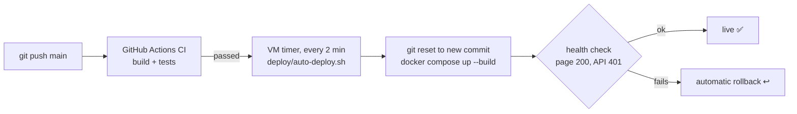

# Room Booking System

**🔗 Live demo: [room-booking.edsuelila.dev](https://room-booking.edsuelila.dev)**: log in with `admin@example.com` (admin) or `user@example.com`, password `password123`.
The demo accounts are shared by all visitors, so data you see may have been changed by someone else.

A full-stack **meeting room booking system** built with **Spring Boot 3 (Java 17)** and **Angular 17**.
Employees browse rooms, see each room's day on a visual timeline, find a free room for a time slot and
book it in two clicks; admins manage rooms, oversee every booking and watch utilization on a dashboard.
Under the hood it focuses on the hard part of any booking system - **never double-booking a room** -
with half-open interval overlap checks, a pessimistic row lock against race conditions, role-based
security with JWT, and 64 automated tests.

   

---

## Features

### Every user
- **Rooms** – card grid with capacity and amenity filters (Projector, Whiteboard, Video Conference, ...).
- **Room day timeline** – 08:00–20:00 in 30-minute rows, previous/next day navigation, booked blocks
  drawn to the minute; click any free row to open the booking form prefilled.
- **Find a room** – pick date, time and head-count, get only the rooms free for the *whole* slot, book one.
- **Booking form** – create or reschedule; friendly amber "that slot was just taken" panel on HTTP 409
  with shortcuts to alternatives.
- **My bookings** – Upcoming / Past & cancelled tabs, reschedule, cancel with inline confirmation.
- Privacy: other people's meetings show as "Booked" – only the owner and admins see titles.

### Admins
- **Dashboard** – bookings today / this week, cancellations, average utilization, busiest hour,
  Chart.js bar charts of utilization per room and bookings per hour.
- **Manage rooms** – create, edit, activate/deactivate (rooms with history are deactivated, never deleted).
- **All bookings** – filter by day, room and status, paged; cancel anyone's future booking.

### Business rules enforced by the API
End after start · same day · within 08:00–20:00 · 15-minute steps · 15 min to 4 h · not in the past ·
attendees ≤ capacity · room must be active · **no overlap with another confirmed booking in the room
(409)** · a user can't be in two meetings at once (409) · only owners (or admins) may change a booking,
and only before it starts.

## Tech stack

| Layer | Technology |
|---|---|
| Backend | Java 17, Spring Boot 3.5, Spring Web, Spring Data JPA (Hibernate 6), Bean Validation |
| Security | Spring Security 6, stateless JWT (jjwt 0.12), BCrypt, `@PreAuthorize` roles |
| Database | PostgreSQL 16 (prod) / H2 in PostgreSQL mode (dev & tests), Flyway migrations |
| API docs | springdoc-openapi (Swagger UI) |
| Frontend | Angular 17 (standalone components, signals, `@if`/`@for`), reactive forms, RxJS, Chart.js |
| Tests | JUnit 5, Mockito, AssertJ, MockMvc, Jasmine/Karma |
| Ops | Docker multi-stage builds, nginx, docker-compose, GitHub Actions CI |

## Quick start

### Option A – run locally (no database to install)

Requirements: Java 17, Node 18.

```bash
# Terminal 1 – API on http://localhost:8084 (in-memory H2, demo data seeded)
cd backend
./mvnw spring-boot:run

# Terminal 2 – Angular on http://localhost:4304 (proxies /api to :8084)
cd frontend
npm install
npm start
```

Open **http://localhost:4304**. Swagger UI: http://localhost:8084/swagger-ui.html.

> Always use the Maven wrapper (`./mvnw`), not a globally installed `mvn`.

### Option B – Docker (PostgreSQL + API + nginx)

```bash
docker compose up --build
```

Open **http://localhost:8094**.

## Running in IntelliJ IDEA or VS Code

Both editors work. The repo includes ready-made run configurations for each one
(`.run/` for IntelliJ, `.vscode/` for VS Code), so you don't have to set anything up by hand.

**You need:** JDK 17+, Node.js 18+ (Angular 17 requires 18.13 or newer) and npm. You don't need Maven:
the project uses the Maven Wrapper (`mvnw`).

| | Backend (Spring Boot API) | Frontend (Angular) |
|---|---|---|
| URL | http://localhost:8084 (Swagger: `/swagger-ui.html`) | http://localhost:4304 |
| Entry point | `backend/src/main/java/com/portfolio/roombooking/RoomBookingApplication.java` | `frontend/` → `npm start` |

Start the **backend first**, then the frontend. The frontend dev server forwards `/api` calls to port 8084.
Then open http://localhost:4304 and use **admin@example.com** or **user@example.com** (password `password123`).

### IntelliJ IDEA (Community or Ultimate)

1. **Open the project:** *File → Open…* and select the **repository root folder** (the one containing `backend/` and `frontend/`).
   If IntelliJ doesn't import Maven automatically, right-click `backend/pom.xml` → **Add as Maven Project**.
2. **Set the JDK:** *File → Project Structure → Project → SDK* → choose a **17** (or newer) JDK.
   If none is listed, use *Add SDK → Download JDK* (for example Eclipse Temurin 17).
3. **Use the Maven Wrapper:** *Settings → Build, Execution, Deployment → Build Tools → Maven* → **Maven home path: Use Maven wrapper**.
4. **Run the backend:** choose **Backend (Spring Boot)** in the run-configuration dropdown (top right) and click ▶ Run or 🐞 Debug.
   Or open `RoomBookingApplication.java` and click the green ▶ next to `main`. Wait for `Started RoomBookingApplication in … seconds` in the console.
5. **Run the frontend:**
   - **Ultimate:** choose the **Frontend (npm start)** run configuration and click ▶. The first time, right-click `frontend/package.json` → **Run 'npm install'**.
   - **Community** (no JavaScript support): open the **Terminal** tool window and run:
     ```bash
     cd frontend
     npm install   # first time only
     npm start
     ```
6. **Run the tests:** choose the **Backend tests** configuration, or right-click `backend/src/test/java` → **Run 'All Tests'**.
   Frontend tests run in the terminal: `cd frontend && npx ng test --watch=false --browsers=ChromeHeadless`.

> **Tip:** in Ultimate, the *Services* tool window shows the Spring Boot app with its endpoints and health.
> To debug, set breakpoints in a controller or service and start **Backend (Spring Boot)** with 🐞 Debug.

### VS Code

1. **Open the folder:** *File → Open Folder…* and select the **repository root**.
2. **Install the recommended extensions** when VS Code prompts you (they're listed in `.vscode/extensions.json`):
   - **Extension Pack for Java**: Java language support, Maven, debugger, test runner
   - **Spring Boot Extension Pack**: Spring Boot tools + Spring Boot Dashboard
   - **Angular Language Service**: template autocompletion and errors

   When the Java extension asks, choose **Trust** and let it import the Maven project
   (the status bar shows "Java: Ready" when it's done).
3. **Run everything with one click:** open *Run and Debug* (Ctrl/Cmd + Shift + D), pick
   **Full stack (backend + frontend)** and press ▶. This starts the Spring Boot API with the debugger attached,
   runs `npm start`, and opens Chrome with the Angular debugger attached.
   The first time, run *Terminal → Run Task… → **Frontend: npm install*** before pressing ▶.
4. **Or run the pieces separately:**
   - Backend: **Backend (Spring Boot)** in *Run and Debug*, or ▶ next to the app in the *Spring Boot Dashboard*,
     or *Terminal → Run Task… → **Backend: run (mvnw spring-boot:run)***.
   - Frontend: *Terminal → Run Task… → **Frontend: npm start***.
5. **Tests:** the *Testing* panel (beaker icon) lists every JUnit test. You can also use
   *Terminal → Run Task… → **Backend: tests*** / **Frontend: tests**.

### Troubleshooting

| Problem | Fix |
|---|---|
| `Port 8084 was already in use` | Another app (or a previous run) is using it. Stop it, or change `server.port` in `backend/src/main/resources/application.yml` **and** `target` in `frontend/proxy.conf.json`. |
| `Port 4304 is already in use` | Run `npx ng serve --port <other>` inside `frontend/`. |
| Login fails / "Cannot reach the server" | The backend isn't running, or not on port 8084. Start it first. |
| Java errors such as "release version 17 not supported" | The project/IDE is using an older JDK. Select JDK 17+ (step 2 above). |
| Red imports in VS Code | Run *Command Palette → **Java: Clean Java Language Server Workspace*** and reload. |
| `ng: command not found` | Use `npm start` / `npx ng …` (they use the project's local Angular CLI) after `npm install`. |
| H2 console | http://localhost:8084/h2-console, JDBC URL `jdbc:h2:mem:roombooking`, user `sa`, empty password (the DB lives in memory and resets on restart). |

## Demo credentials

| Role | Email | Password |
|---|---|---|
| Admin | `admin@example.com` | `password123` |
| User | `user@example.com` | `password123` |
| User | `alice@example.com`, `bob@example.com` | `password123` |

The login page has **"Use admin demo"** and **"Use user demo"** links.

## Screenshots


| Rooms | Booking form (prefilled from a timeline click) | My bookings |
|---|---|---|
|  |  |  |

## Running the tests

```bash
cd backend && ./mvnw -B verify          # 44 tests: unit (Mockito) + integration (MockMvc + H2)
cd frontend && npx ng test --watch=false --browsers=ChromeHeadless   # 20 specs
```

## Continuous deployment

Every push to `main` is built and tested by GitHub Actions (`.github/workflows/ci.yml`). If CI passes,
the new version is **deployed automatically** to a home-lab VM (http://192.168.86.15:8094).



The VM sits in a private network that GitHub can't reach, so the VM **pulls**: a systemd timer runs
[`deploy/auto-deploy.sh`](deploy/auto-deploy.sh), which only deploys commits whose CI checks succeeded, and rolls back if the
build or the health check fails. This avoids opening any port to the internet, and avoids self-hosted
runners, which GitHub advises against for public repositories.

**One-time setup on the VM** (user in the `docker` group, repo cloned to `~/apps/room-booking`):

```bash
cd ~/apps/room-booking && ./deploy/install-auto-deploy.sh
journalctl -u auto-deploy@room-booking -f        # watch deployments
```

Secrets (DB password, `JWT_SECRET`) live in an untracked `docker-compose.override.yml` on the VM and are never committed.

## Documentation

**[docs/HOW-IT-WORKS.md](docs/HOW-IT-WORKS.md)** – a detailed guide: architecture diagrams, the request
lifecycle of a booking, security and roles, data model, every business rule and the test that covers
it, overlap detection and concurrency deep-dive, full API reference, frontend timeline maths,
deployment, and interview talking points.

The code itself is heavily commented for learning purposes.

## Project structure

```
room-booking/
├── backend/                     Spring Boot REST API
│   ├── src/main/java/com/portfolio/roombooking/
│   │   ├── auth/                register / login / me
│   │   ├── user/                User entity, Role enum
│   │   ├── room/                rooms CRUD, availability, day schedule
│   │   ├── booking/             bookings, time rules, overlap queries, locking
│   │   ├── stats/               admin dashboard numbers
│   │   ├── security/            JWT service + filter, JSON 403 handler
│   │   ├── config/              Spring Security, Clock, OpenAPI, demo data
│   │   └── common/              ApiError, exceptions, global handler, PageResponse
│   ├── src/main/resources/      application.yml, application-prod.yml, Flyway SQL
│   └── src/test/java/...        unit + integration tests
├── frontend/                    Angular 17 SPA
│   └── src/app/
│       ├── core/                models, auth (service/interceptor/guards), API services
│       ├── shared/              time + timeline helpers, error messages, pipe
│       └── features/            auth, rooms, find-room, bookings, admin pages
├── docs/HOW-IT-WORKS.md         the in-depth guide
├── docker-compose.yml           Postgres + backend + frontend
└── .github/workflows/ci.yml     build & test on every push
```
