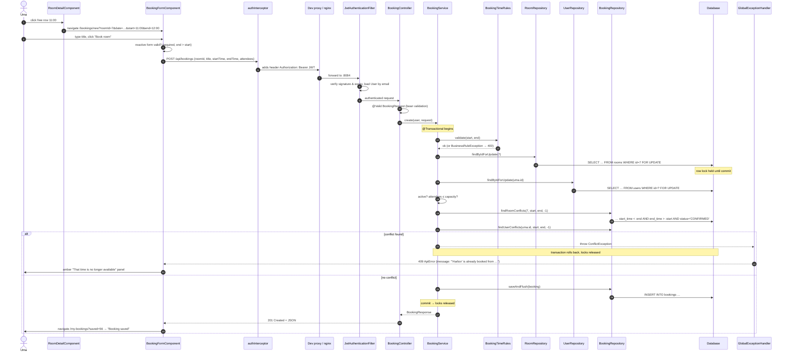
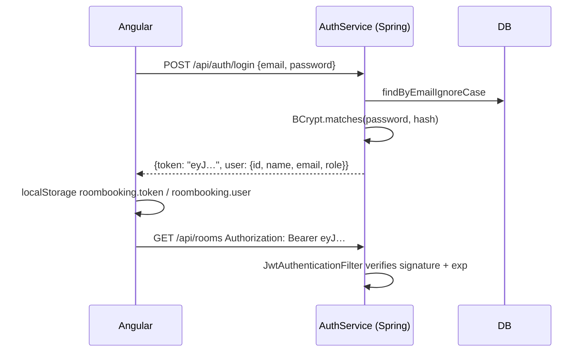
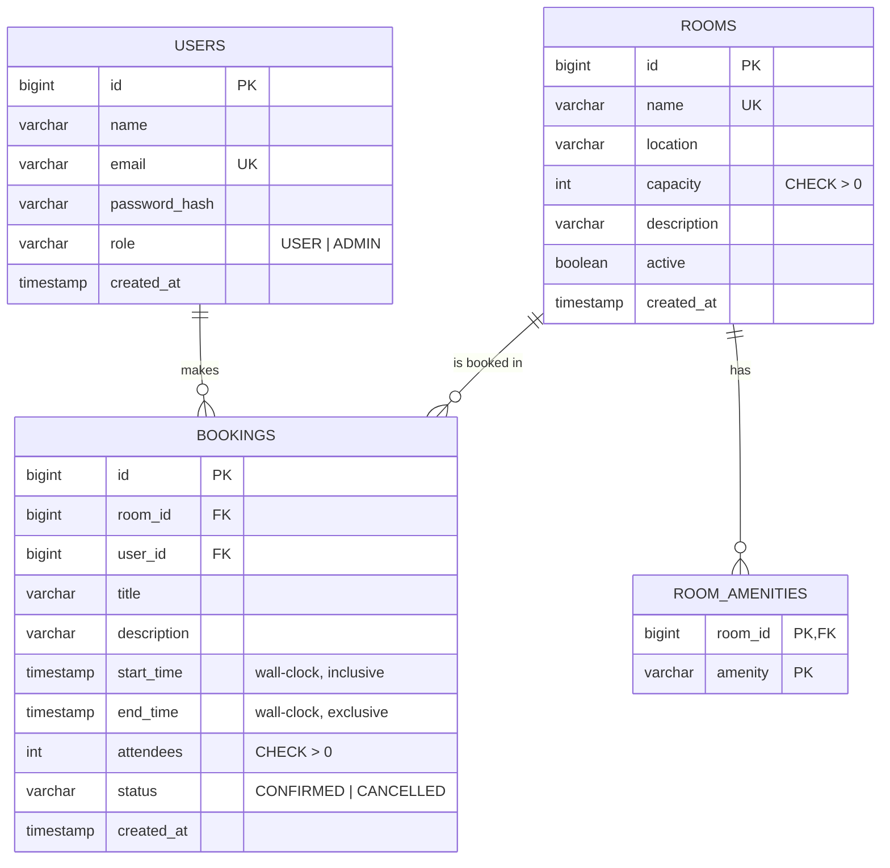

# How the Room Booking System Works

A guided tour of the whole application, from the button you click to the row in the database and
back. It is written for a developer who is new to Spring Boot and Angular, and doubles as preparation
material for talking about the project in a job interview.

**Contents**

1. [Overview & features](#1-overview--features)
2. [Tech stack and why](#2-tech-stack-and-why)
3. [Architecture](#3-architecture)
4. [Project structure](#4-project-structure)
5. [Request lifecycle: booking a room](#5-request-lifecycle-booking-a-room)
6. [Authentication, authorization & roles](#6-authentication-authorization--roles)
7. [Data model](#7-data-model)
8. [Business rules](#8-business-rules)
9. [API reference](#9-api-reference)
10. [Backend layer by layer](#10-backend-layer-by-layer)
11. [Frontend explained](#11-frontend-explained)
12. [Error handling end to end](#12-error-handling-end-to-end)
13. [Testing](#13-testing)
14. [Configuration, profiles & environment variables](#14-configuration-profiles--environment-variables)
15. [Docker & deployment](#15-docker--deployment)
16. [Interview talking points](#16-interview-talking-points)
17. [Glossary](#17-glossary)

---

## 1. Overview & features

The app lets people in an office reserve meeting rooms. It looks simple, but booking systems are a
classic interview topic because of three hard problems that this project solves explicitly:

1. **Overlaps** – two bookings for the same room must never overlap, yet back-to-back meetings
   (10:00–11:00 followed by 11:00–12:00) must be allowed.
2. **Concurrency** – two people clicking "Book" at the same millisecond must not both succeed.
3. **Time** – what does "10:00" mean, which time zone, what is "now", and how do you test that?

### Roles

| | USER | ADMIN |
|---|---|---|
| Browse/filter rooms, see room timelines | ✅ | ✅ |
| Find a free room for a slot | ✅ | ✅ |
| Create bookings | ✅ | ✅ |
| Reschedule / cancel **own** future bookings | ✅ | ✅ |
| Reschedule / cancel **anyone's** future bookings | ❌ | ✅ |
| See titles of other people's bookings | ❌ ("Booked") | ✅ |
| Create / edit / activate / deactivate / delete rooms | ❌ | ✅ |
| See all bookings (filters, paging) | ❌ | ✅ |
| Dashboard statistics | ❌ | ✅ |

Public registration always creates a USER. Admins come from the demo seeder (or would be promoted
directly in the database in a real deployment).

### Pages

| URL | Page | Who |
|---|---|---|
| `/login`, `/register` | Sign in / sign up (with "use admin demo" / "use user demo") | guests |
| `/rooms` | Room cards with capacity and amenity filters | users |
| `/rooms/:id?date=` | Room info + day timeline, click a free slot to book | users |
| `/find` | Find a room free for a whole slot | users |
| `/bookings/new?roomId=&date=&start=&end=` | Booking form (create) | users |
| `/bookings/:id/edit` | Booking form (reschedule) | owner/admin |
| `/my-bookings` | Upcoming / Past & cancelled tabs | users |
| `/admin/dashboard` | Stat cards + charts | admin |
| `/admin/rooms` | Rooms table + form | admin |
| `/admin/bookings` | All bookings, filtered and paged | admin |

---

## 2. Tech stack and why

| Choice | Why |
|---|---|
| **Java 17 + Spring Boot 3.5** | The most common enterprise backend stack. Auto-configuration means very little boilerplate; records make DTOs one-liners. |
| **Spring Data JPA / Hibernate** | Entities map to tables; repositories are interfaces whose implementation Spring generates. Custom JPQL where it matters (overlaps). |
| **Spring Security + JWT (jjwt)** | Stateless authentication suits a SPA + REST API: no server sessions, easy horizontal scaling. |
| **`@PreAuthorize` method security** | Role rules sit right on the endpoint they protect, readable in code review. |
| **PostgreSQL** in prod, **H2 (PostgreSQL mode)** in dev/tests | Real relational DB in production, zero-install DB for development and fast tests. Same Flyway SQL runs on both. |
| **Flyway** | Versioned, reviewable schema changes; Hibernate only *validates* the schema (`ddl-auto: validate`). |
| **springdoc-openapi** | Free, always-up-to-date Swagger UI for trying the API. |
| **Angular 17** | Opinionated, batteries-included framework (router, forms, HTTP, DI, testing) used widely in enterprises. Standalone components, **signals** and the new `@if/@for` control flow are the modern idioms. |
| **Reactive forms** | Form model in TypeScript: typed, testable, cross-field validators (end after start). |
| **Chart.js** | Small, well-known charting library for the dashboard. |
| **JUnit 5, Mockito, MockMvc** | Unit tests in milliseconds; integration tests through the real HTTP + security + SQL stack. |
| **Docker + nginx + docker-compose** | One-command full stack; nginx serves the SPA and proxies the API from one origin. |
| **GitHub Actions** | CI badge proves the project builds and its tests pass. |

---

## 3. Architecture

```mermaid
flowchart LR
    subgraph Browser
        UI[Angular SPA<br/>components + signals]
        INT[authInterceptor<br/>adds Bearer JWT]
        UI --> INT
    end

    INT -->|"/api/... (same origin)"| PROXY{{"dev: ng serve proxy (4304)<br/>prod: nginx (8094 → 80)"}}

    subgraph Spring Boot API
        direction TB
        F[Security filter chain<br/>JwtAuthenticationFilter<br/>URL rules → 401/403]
        C[Controllers<br/>@RestController, @Valid, @PreAuthorize]
        S[Services<br/>@Transactional business rules<br/>BookingTimeRules, ownership]
        R[Repositories<br/>Spring Data JPA, JPQL overlap queries,<br/>@Lock PESSIMISTIC_WRITE]
        EH[GlobalExceptionHandler<br/>→ ApiError JSON]
        F --> C --> S --> R
        C -.exceptions.-> EH
    end

    PROXY --> F
    R --> DB[(PostgreSQL / H2<br/>Flyway schema)]
```

**Layers and their single responsibility**

| Layer | Knows about | Does NOT know about |
|---|---|---|
| Angular components | what to show, user input | SQL, other users' permissions |
| Interceptor / guards | tokens, redirects | business rules |
| Security filter chain | who is calling (JWT) | bookings |
| Controllers | HTTP: paths, params, status codes, DTO validation | SQL, transactions |
| Services | business rules, transactions, ownership | HTTP |
| Repositories | queries, locks | business rules |
| Database | constraints, row locks | anything else |

**Why a proxy?** The browser only ever talks to one origin (`localhost:4304` in dev, `localhost:8094`
in Docker). The dev server (`proxy.conf.json`) or nginx (`nginx.conf`) forwards `/api/*` to Spring
Boot. That avoids most CORS issues and means the Angular code uses relative URLs (`/api/rooms`)
everywhere.

> **Gotcha learned the hard way:** `proxy.conf.json` uses `"changeOrigin": false`. With `true`, the
> proxy rewrites the `Host` header to `localhost:8084` while the browser's `Origin` header still says
> `http://localhost:4304`. Spring then treats the request as cross-origin and, if that origin is not
> allowed, answers **403 "Invalid CORS request"** – login fails in the browser even though `curl`
> works (curl sends no `Origin`). We keep `changeOrigin: false` *and* list `http://localhost:4304` in
> `app.cors.allowed-origins`, so the browser path works either way.

---

## 4. Project structure

```
room-booking/
├── README.md                                   pitch, features, quick start, credentials
├── docs/HOW-IT-WORKS.md                        this guide
├── docker-compose.yml                          Postgres + backend + frontend, one command
├── .gitignore                                  ignores target/, node_modules/, dist/, IDE files
├── .github/workflows/ci.yml                    CI: backend ./mvnw verify, frontend test + build
│
├── backend/
│   ├── pom.xml                                 Maven build: Spring Boot 3.5.6, jjwt, Flyway, H2, Postgres
│   ├── mvnw, mvnw.cmd, .mvn/wrapper/           Maven Wrapper: pins Maven 3.9.9 (always use ./mvnw)
│   ├── Dockerfile                              multi-stage: Maven build → JRE-alpine runtime, non-root
│   ├── .dockerignore                           keeps target/ out of the Docker build context
│   └── src/
│       ├── main/java/com/portfolio/roombooking/
│       │   ├── RoomBookingApplication.java     main(); @SpringBootApplication; package overview
│       │   ├── auth/
│       │   │   ├── AuthController.java         POST /api/auth/register, /login; GET /me
│       │   │   ├── AuthService.java            BCrypt check, USER-only registration, issues JWT
│       │   │   └── dto/
│       │   │       ├── AuthResponse.java       { token, user }
│       │   │       ├── LoginRequest.java       email + password (@NotBlank)
│       │   │       ├── RegisterRequest.java    name, email, password (no role field on purpose)
│       │   │       └── UserResponse.java       id, name, email, role (never the hash)
│       │   ├── user/
│       │   │   ├── Role.java                   USER / ADMIN + "ROLE_" authority mapping
│       │   │   ├── User.java                   @Entity users; implements UserDetails
│       │   │   └── UserRepository.java         findByEmailIgnoreCase, findByIdForUpdate (row lock)
│       │   ├── room/
│       │   │   ├── Room.java                   @Entity rooms; @ElementCollection amenities
│       │   │   ├── RoomRepository.java         filters, amenities list, findByIdForUpdate, findAvailable
│       │   │   ├── RoomSpecifications.java     composable WHERE clauses (capacity, amenities, active)
│       │   │   ├── RoomService.java            list/get/available/schedule + admin CRUD rules
│       │   │   ├── RoomController.java         /api/rooms endpoints, admin ones @PreAuthorize
│       │   │   └── dto/
│       │   │       ├── RoomRequest.java        validated admin input
│       │   │       ├── RoomResponse.java       room JSON with sorted amenities
│       │   │       └── ScheduleEntryResponse.java  timeline block ("Booked" for non-owners)
│       │   ├── booking/
│       │   │   ├── Booking.java                @Entity bookings; LocalDateTime wall-clock times
│       │   │   ├── BookingStatus.java          CONFIRMED / CANCELLED (soft delete)
│       │   │   ├── BookingRepository.java      overlap JPQL (half-open), schedules, my bookings
│       │   │   ├── BookingSpecifications.java  admin list filters (date, room, status)
│       │   │   ├── BookingTimeRules.java       pure time rules: order, same day, 15 min, hours, past
│       │   │   ├── BookingService.java         create/reschedule/cancel with locks + overlap checks
│       │   │   ├── BookingController.java      /api/bookings endpoints
│       │   │   └── dto/
│       │   │       ├── BookingRequest.java     validated create/reschedule body
│       │   │       └── BookingResponse.java    booking JSON with room and user names
│       │   ├── stats/
│       │   │   ├── StatsService.java           weekly counts, utilization %, busiest hours
│       │   │   ├── StatsController.java        GET /api/stats (admin)
│       │   │   └── dto/
│       │   │       ├── StatsResponse.java      dashboard payload
│       │   │       ├── RoomUtilization.java    per-room minutes and %
│       │   │       └── HourCount.java          bookings touching each hour
│       │   ├── security/
│       │   │   ├── JwtService.java             sign/verify HS256 tokens (sub, name, role, exp)
│       │   │   ├── JwtAuthenticationFilter.java  Bearer header → SecurityContext
│       │   │   └── JsonAccessDeniedHandler.java  JSON body for filter-level 403s
│       │   ├── config/
│       │   │   ├── SecurityConfig.java         filter chain, public URLs, @EnableMethodSecurity, CORS, BCrypt
│       │   │   ├── ClockConfig.java            injectable Clock (testable "now")
│       │   │   ├── OpenApiConfig.java          Swagger metadata + Bearer auth button
│       │   │   └── DemoDataSeeder.java         4 users, 8 rooms, ~55 bookings (idempotent)
│       │   └── common/
│       │       ├── ApiError.java               uniform error JSON
│       │       ├── BusinessRuleException.java  → 400
│       │       ├── ConflictException.java      → 409
│       │       ├── ResourceNotFoundException.java → 404
│       │       ├── GlobalExceptionHandler.java @RestControllerAdvice: exception → status + ApiError
│       │       └── PageResponse.java           stable paging JSON
│       ├── main/resources/
│       │   ├── application.yml                 dev defaults: port 8084, H2, seed data, JWT, CORS
│       │   ├── application-prod.yml            prod overrides via env vars (Postgres, port, CORS)
│       │   └── db/migration/V1__create_tables.sql  users, rooms, room_amenities, bookings + indexes
│       └── test/java/com/portfolio/roombooking/
│           ├── BookingApiIntegrationTest.java  20 MockMvc tests: security, overlaps, concurrency, rules
│           ├── booking/BookingServiceTest.java 11 Mockito unit tests: lock order, conflicts, ownership
│           ├── booking/BookingTimeRulesTest.java 12 tests (incl. parameterized table of time rules)
│           └── stats/StatsServiceTest.java     dashboard maths with a fixed clock
│
└── frontend/
    ├── package.json, package-lock.json         Angular 17, Chart.js; "start" = ng serve --port 4304
    ├── angular.json                            build/serve/test config; proxyConfig + port 4304
    ├── proxy.conf.json                         dev proxy /api → http://localhost:8084 (changeOrigin false)
    ├── Dockerfile                              multi-stage: node build → nginx
    ├── nginx.conf                              static files + /api reverse proxy + SPA fallback
    ├── .dockerignore                           keeps node_modules/dist out of the image build
    ├── tsconfig*.json, .editorconfig           TypeScript strict mode, editor settings (scaffold)
    ├── README.md                               frontend-only commands
    └── src/
        ├── index.html                          <title>Room Booking</title>, <app-root>
        ├── main.ts                             bootstrapApplication(AppComponent, appConfig)
        ├── styles.scss                         design system: tokens, buttons, inputs, badges, tabs
        └── app/
            ├── app.config.ts                   provideRouter(withComponentInputBinding), HttpClient + interceptor
            ├── app.routes.ts                   lazy routes; authGuard / guestGuard / roleGuard
            ├── app.component.{ts,html,scss}    shell: role-aware navbar + <router-outlet>
            ├── core/
            │   ├── models.ts                   TS interfaces mirroring the Java DTOs
            │   ├── auth/auth.service.ts        signals: currentUser, isLoggedIn, isAdmin; login/logout
            │   ├── auth/auth.interceptor.ts    adds Bearer token; logs out on 401
            │   ├── auth/auth.guard.ts          authGuard, guestGuard, roleGuard (data.roles)
            │   ├── auth/*.spec.ts              service, interceptor and roleGuard tests
            │   └── api/{room,booking,stats}.service.ts  typed HTTP wrappers
            ├── shared/
            │   ├── time.ts                     string-based date/time helpers (no TZ drift)
            │   ├── timeline.ts                 pure timeline maths: slots, block positions, suggestions
            │   ├── time-range.pipe.ts          {{ booking | timeRange }} → "10:00 – 11:00"
            │   ├── error-message.ts            HttpErrorResponse → human sentence; isConflict()
            │   └── time.spec.ts, timeline.spec.ts  unit tests for the helpers
            └── features/
                ├── auth/login.component.*      login + "use admin/user demo"
                ├── auth/register.component.*   sign-up
                ├── auth/auth-page.scss         shared centered-card layout
                ├── rooms/room-list.component.* card grid + filters
                ├── rooms/room-detail.component.* info + day timeline
                ├── find-room/find-room.component.* availability search
                ├── bookings/booking-form.component.* create / reschedule, 409 panel
                ├── bookings/my-bookings.component.* tabs, cancel inline, reschedule
                ├── admin/admin-dashboard.component.* stat cards + Chart.js
                ├── admin/manage-rooms.component.* rooms table + form
                └── admin/all-bookings.component.* filters + paging + cancel
```

---

## 5. Request lifecycle: booking a room

Let's follow Uma (a USER) who opens the **Harbor** room page, clicks the free 11:00 row on tomorrow's
timeline, types a title and presses **Book room**.



Step by step in words:

1. **Timeline click.** `RoomDetailComponent.pickSlot(i)` checks the row is free, not past, and the room
   active, then navigates to `/bookings/new` with query params. `suggestedEnd()` proposes one hour if the
   next row is free too.
2. **Form prefill.** Thanks to `withComponentInputBinding()`, the query params arrive as `@Input()`s of
   `BookingFormComponent` and are patched into the reactive form.
3. **Client validation.** Required fields, the group validator `endAfterStart`, and a capacity hint
   computed from the selected room. The start/end `<select>`s only offer 15-minute values.
4. **HTTP call.** The component builds `"2026-10-15T11:00:00"` strings with `toLocalDateTime()` and calls
   `BookingService.create()`. The **interceptor** clones the request with the `Authorization` header.
5. **Proxy.** `ng serve` forwards `/api/*` to `http://localhost:8084` (nginx does the same in Docker).
6. **Security filter.** `JwtAuthenticationFilter` verifies the token and puts the `User` entity into the
   `SecurityContext`. `anyRequest().authenticated()` lets it through.
7. **Controller.** `@Valid` runs bean validation (e.g. title not blank, attendees ≥ 1). Failure → 400
   with `fieldErrors`. `@AuthenticationPrincipal User user` injects Uma.
8. **Service, in one transaction.** Time rules → lock room row → lock user row → room rules → room
   overlap → user overlap → insert. Any exception rolls everything back.
9. **Response.** A `BookingResponse` record is serialized to JSON with `201 Created`.
10. **Error path.** Exceptions travel to `GlobalExceptionHandler`, which maps them to `ApiError` JSON; the
    form shows 409s in the amber conflict panel with "Find another room at this time".

---

## 6. Authentication, authorization & roles

### 6.1 Authentication = "who are you?" (JWT)



* **Passwords** are stored as **BCrypt** hashes (salted, deliberately slow). Login compares with
  `passwordEncoder.matches`. The error is the same for unknown email and wrong password
  ("Invalid email or password") so attackers cannot probe which emails exist.
* **The token** (`JwtService.generateToken`) is HS256-signed with `app.jwt.secret` and contains
  `sub` = email, `name`, `role`, `iat`, `exp` (24 h).
* **Stateless:** the server keeps no session. Each request carries the token; the filter verifies the
  signature and expiry (`Jwts.parser().verifyWith(key)`) and **re-loads the user from the database**.
  That way a deleted or demoted user loses access immediately, and the `role` claim is never trusted
  for authorization – it only exists so clients can display role-based UI.
* **Logout** is client-side: delete the token. (Trade-off: a stolen token stays valid until it expires.
  Mitigations are listed in section 16.)

### 6.2 Authorization = "what may you do?" – three layers

| Layer | Where | Example | Failure |
|---|---|---|---|
| URL rules | `SecurityConfig.securityFilterChain` | `/api/auth/login` public; `/api/stats/**` `hasRole('ADMIN')`; everything else `authenticated()` | 401 (no/invalid token) or JSON 403 |
| Method rules | `@PreAuthorize("hasRole('ADMIN')")` on controller methods | `POST /api/rooms`, `GET /api/bookings`, `GET /api/stats` | 403 `ApiError` |
| Data rules | Services | "only the owner or an admin may cancel booking 42"; titles hidden in schedules | 403 / redacted data |

`@EnableMethodSecurity` on `SecurityConfig` is what makes `@PreAuthorize` work. Forgetting it is a
classic silent security bug, which is why `regularUsers_get403JsonOnAdminEndpoints` exists.

**Role → authority mapping.** `Role.ADMIN.authority()` returns `"ROLE_ADMIN"`, and
`User.getAuthorities()` returns it. `hasRole('ADMIN')` checks for exactly that string (Spring adds the
`ROLE_` prefix).

**401 vs 403.**
* **401 Unauthorized** = "I don't know who you are" (missing/expired/forged token). Produced by
  `HttpStatusEntryPoint(UNAUTHORIZED)`. The Angular interceptor reacts by logging out.
* **403 Forbidden** = "I know who you are, and you may not do this". Produced by
  `GlobalExceptionHandler.handleAccessDenied` (method/service level) or `JsonAccessDeniedHandler`
  (URL level). The UI shows the message; it does not log out.

### 6.3 In the frontend

* `AuthService` keeps `currentUser` in a **signal** and derives `isLoggedIn` and `isAdmin` with
  `computed()`. The navbar reads `auth.isAdmin()` and shows admin links only to admins.
* Guards: `authGuard` (logged in), `guestGuard` (logged out), `roleGuard` (reads `route.data.roles`).
  The `/admin` parent route has `canActivate: [roleGuard], data: { roles: ['ADMIN'] }`, protecting all
  its children at once. Admin pages are lazy-loaded, so regular users never download their code.
* **Guards are UX, not security.** Anyone can edit localStorage to claim `role: "ADMIN"`; they'd see the
  admin menu, and every admin API call would still return 403.

---

## 7. Data model



### Tables and columns

**users** – accounts.

| Column | Type | Notes |
|---|---|---|
| id | BIGINT identity | primary key, generated by the DB |
| name | VARCHAR(100) | display name |
| email | VARCHAR(255) UNIQUE | login; looked up case-insensitively |
| password_hash | VARCHAR(255) | BCrypt hash |
| role | VARCHAR(20) default 'USER' | `@Enumerated(EnumType.STRING)` |
| created_at | TIMESTAMP | audit |

**rooms** – bookable rooms.

| Column | Type | Notes |
|---|---|---|
| id | BIGINT identity | |
| name | VARCHAR(100) UNIQUE | DB-enforced uniqueness; service also checks case-insensitively for a friendly 409 |
| location | VARCHAR(150) | "Floor 3, East wing" |
| capacity | INTEGER CHECK > 0 | max attendees |
| description | VARCHAR(1000) | optional |
| active | BOOLEAN default TRUE | inactive = not bookable |
| created_at | TIMESTAMP | set by `@PrePersist` |

**room_amenities** – the `@ElementCollection Set<String> amenities` of a room.

| Column | Type | Notes |
|---|---|---|
| room_id | BIGINT FK → rooms ON DELETE CASCADE | part of PK |
| amenity | VARCHAR(50) | part of PK (a Set has no duplicates) |

**bookings** – reservations.

| Column | Type | Notes |
|---|---|---|
| id | BIGINT identity | |
| room_id | BIGINT FK → rooms | no cascade: rooms with bookings are deactivated, not deleted |
| user_id | BIGINT FK → users | owner |
| title | VARCHAR(150) | |
| description | VARCHAR(1000) | optional |
| start_time | TIMESTAMP | office wall-clock, inclusive |
| end_time | TIMESTAMP | exclusive; `CHECK (end_time > start_time)` |
| attendees | INTEGER CHECK > 0 | |
| status | VARCHAR(20) | `CONFIRMED` / `CANCELLED` – cancellations are soft |
| created_at | TIMESTAMP | audit |

**Indexes** (`V1__create_tables.sql`):
* `idx_bookings_room_time (room_id, status, start_time, end_time)` – overlap checks and room schedules;
* `idx_bookings_user_time (user_id, status, start_time)` – "my bookings" and user overlaps;
* `idx_bookings_start (start_time)` – admin list by day and weekly stats.

### Why `@ElementCollection` for amenities?

Amenities are just labels with no identity of their own. An `@ElementCollection` stores them in a
"collection table" owned by the room – no `Amenity` entity, repository or CRUD needed. If amenities
later needed icons, descriptions or admin management, you'd promote them to an entity with a
`@ManyToMany`.

### Time-zone decision

`start_time`/`end_time` are **`LocalDateTime` / `TIMESTAMP WITHOUT TIME ZONE`** – office wall-clock
time. A meeting room is in one building and one time zone; "10:00" means 10:00 on the wall clock.
The rules (08:00–20:00, 15-minute steps) are wall-clock rules, the UI shows exactly what was typed, and
there are no DST conversion bugs. "Now" comes from the injected `Clock` in the server's zone (set `TZ`
in Docker). `created_at` is an `Instant` because it's an audit timestamp. Multi-time-zone support is
listed in section 16.

### Flyway

On startup Flyway runs any `db/migration/V<n>__*.sql` not yet recorded in `flyway_schema_history`.
Hibernate runs with `ddl-auto: validate`: it checks entities match the tables and refuses to start
otherwise, but never changes the schema. To evolve the schema add `V2__add_room_floor.sql`; never edit
an applied migration (Flyway would detect the checksum change and fail). The same SQL runs on H2 in
`MODE=PostgreSQL` and on real PostgreSQL.

---

## 8. Business rules

Every rule, where it is enforced, the HTTP status, and the test that proves it.

| # | Rule | Enforced in | Status | Test(s) |
|---|---|---|---|---|
| 1 | End must be after start | `BookingTimeRules.validate` (+ form validator, + DB CHECK) | 400 | `BookingTimeRulesTest.rejectsInvalidSlots` rows 1–2 |
| 2 | Start and end on the same day | `BookingTimeRules` | 400 | `rejectsInvalidSlots` "same day" |
| 3 | Within business hours 08:00–20:00 (end may equal 20:00) | `BookingTimeRules` | 400 | `rejectsInvalidSlots` "business hours"; `acceptsAValidSlot…ClosingTime`; integration `timeRulesAndCapacity_return400…` |
| 4 | 15-minute increments, zero seconds | `BookingTimeRules.isOnSlotBoundary` (+ UI selects) | 400 | `rejectsInvalidSlots` "15-minute" ×3; integration |
| 5 | Duration 15 min – 4 h | `BookingTimeRules` | 400 | `rejectsInvalidSlots` "longer than 4 hours"; integration |
| 6 | Not in the past | `BookingTimeRules` (fixed `Clock`) | 400 | `rejectsInvalidSlots` "in the past" ×2 |
| 7 | Attendees ≤ room capacity (and ≥ 1) | `BookingService` (+ `@Min(1)`, UI hint) | 400 | `BookingServiceTest.create_rejectsMoreAttendeesThanCapacity`; integration |
| 8 | Room must be active | `BookingService` | 400 | `create_rejectsInactiveRoom`; integration `roomsWithBookings_cannotBeDeleted_andInactiveRoomsCannotBeBooked` |
| 9 | **No overlap with another CONFIRMED booking in the room** | `BookingRepository.findRoomConflicts` + room row lock | 409 | integration `overlapDetection_halfOpenIntervals` (7 cases), `cancellingABooking_freesTheSlot`, `concurrentBookingsOfTheSameSlot_exactlyOneWins`; unit `create_rejectsOverlap…` |
| 10 | A user can't have two overlapping bookings | `findUserConflicts` + user row lock | 409 | integration `aUserCannotBeInTwoRoomsAtOnce`; unit `create_rejectsWhenTheUserIsAlreadyInAnotherMeeting` |
| 11 | Rescheduling excludes the booking itself | `excludeId` parameter | – | integration `reschedule_mayOverlapItsOwnOldSlot…`; unit `reschedule_excludesTheBookingItself…` |
| 12 | Only owner or admin may reschedule/cancel | `BookingService.checkCanModify` | 403 | integration `ownership_otherUsersGet403_adminsMayCancelAnyBooking`; unit `cancel_byAnotherUser_isForbidden`, `cancel_byAdmin_isAllowed…` |
| 13 | Only future (not started) bookings may change | `checkCanModify` | 400 | unit `cancel_aBookingThatAlreadyStarted_isRejected` |
| 14 | Cancelled bookings can't be cancelled again | `checkCanModify` | 409 | unit `cancel_twice_returnsConflict` |
| 15 | Room names unique | `RoomService` + DB UNIQUE | 409 | handled by `ConflictException` / `DataIntegrityViolationException` |
| 16 | Rooms with bookings can't be deleted (deactivate instead) | `RoomService.delete` | 409 | integration `roomsWithBookings_cannotBeDeleted…` |
| 17 | Only admins manage rooms / see all bookings / stats | `@PreAuthorize`, URL rule | 403 | integration `regularUsers_get403JsonOnAdminEndpoints` |
| 18 | Public sign-up always creates USER | `AuthService.register` / no role field in DTO | – | integration `publicRegistration_alwaysCreatesAUser…` |
| 19 | Schedule hides other people's titles | `RoomService.toScheduleEntry` | – | integration `schedule_hidesTitlesFromOtherUsers` |
| 20 | Rooms offered by "Find a room" are free for the whole slot and large enough | `RoomRepository.findAvailable` | – | integration `availableRooms_excludeBookedAndTooSmallRooms` |

**Validation order** in `BookingService.createOrReschedule`: cheap pure checks first (no DB, no locks
for obviously invalid requests – verified by `create_rejectsInvalidTimes_beforeTouchingTheDatabase`),
then locks, then DB-dependent checks, then the insert.

### 8.1 Deep dive: overlap detection

Each booking occupies the **half-open interval** `[start, end)`: it includes its start minute and
excludes its end minute. Two intervals A and B overlap **if and only if**

```
A.start < B.end   AND   A.end > B.start
```

Existing booking **E = 10:00–11:00**:

```
           09:00     10:00     11:00     12:00
  E                    [=========)
  N1  [=========)                            09:00-10:00  10:00 < 10:00 is false -> OK (touches)
  N2                             [=========) 11:00-12:00  11:00 > 11:00 is false -> OK (touches)
  N3            [=========)                  09:30-10:30  both true              -> CONFLICT
  N4                         [=========)     10:30-11:30  both true              -> CONFLICT
  N5                  [===)                  10:15-10:45  inside                 -> CONFLICT
  N6       [=====================)           09:00-12:00  encloses               -> CONFLICT
  N7                   [=========)           10:00-11:00  identical              -> CONFLICT
```

Why this formula is the right one:

* **It's the negation of "no overlap".** A and B do *not* overlap exactly when A ends before B starts
  (`A.end <= B.start`) or A starts after B ends (`A.start >= B.end`). Negate with De Morgan's law and you
  get `A.end > B.start AND A.start < B.end`. One formula, every case.
* **Strict `<` / `>` allow back-to-back meetings.** With `<=` the 11:00 meeting would collide with the
  one ending at 11:00.
* **It's index-friendly SQL.** `room_id = ? AND status = 'CONFIRMED' AND start_time < ? AND end_time > ?`
  uses `idx_bookings_room_time`.

In JPQL (`BookingRepository.findRoomConflicts`):

```java
select b from Booking b
where b.room.id = :roomId
  and b.status = com.portfolio.roombooking.booking.BookingStatus.CONFIRMED
  and b.startTime < :end
  and b.endTime > :start
  and b.id <> :excludeId
```

* **Only CONFIRMED** bookings block a slot, so cancelling frees it immediately.
* **`excludeId`** – when rescheduling booking #42 we pass 42 so a booking never conflicts with its own old
  time (moving 10:00–11:00 to 10:30–11:30 is fine). For new bookings we pass `NO_ID = -1`. A sentinel
  instead of `(:excludeId is null or b.id <> :excludeId)` avoids PostgreSQL's "could not determine data
  type of parameter" error with null parameters.

The same formula appears in several places, deliberately identical: room conflicts, user conflicts,
`RoomRepository.findAvailable` (as `not exists (...)`), the dashboard's busiest-hours count, and the
frontend timeline's busy-row calculation.

### 8.2 Deep dive: concurrency and pessimistic locking

**The race.** "Check then insert" is not atomic:

```
time →
Alice: BEGIN  SELECT overlaps (none) ............ INSERT  COMMIT
Bob:     BEGIN  SELECT overlaps (none) ............ INSERT  COMMIT     ← double booking!
```

Both checks run before either insert is visible. A unique constraint can't help: the two rows have
different start/end times, and "overlap" isn't equality.

**The fix: lock the room row.** `RoomRepository.findByIdForUpdate` is annotated
`@Lock(LockModeType.PESSIMISTIC_WRITE)`, so Hibernate issues `SELECT … FROM rooms WHERE id = ? FOR UPDATE`.
The database lets one transaction hold that row lock; the other **waits** on that line:

```
Alice: BEGIN  LOCK room 7 ✓  SELECT (none)  INSERT  COMMIT (unlock)
Bob:   BEGIN  LOCK room 7 … waiting …………………………………………→ ✓  SELECT (sees Alice's row!) → 409
```

Why this works:
* Every booking for a room passes through the same lock, so checks for the **same room** are serialized.
* Different rooms don't block each other – the lock is per room row, not a table lock.
* The lock is held until the `@Transactional` method commits/rolls back. That's why the check and the
  insert live in the same service method and why `saveAndFlush` runs before returning.
* Under READ COMMITTED (the default in PostgreSQL and H2), Bob's overlap query runs *after* he acquires
  the lock, i.e. after Alice committed, so it sees her booking.

**The user lock.** Rule 10 (no double-booking yourself) spans rooms, so the room lock doesn't serialize
it. We also lock the owner's `users` row (`UserRepository.findByIdForUpdate`).

**Deadlock avoidance.** Locks are always taken in the same order – room, then user. Two transactions
can then never each hold a lock the other needs. `BookingServiceTest.create_locksRoomThenUser…` asserts
this order with Mockito's `InOrder`.

**Proof.** `BookingApiIntegrationTest.concurrentBookingsOfTheSameSlot_exactlyOneWins` starts two
threads behind a `CountDownLatch`, both booking 09:00–10:00 in the same room, and asserts exactly one
`ConflictException`.

**Alternatives (interview material):**

| Approach | How | Pros | Cons |
|---|---|---|---|
| Pessimistic lock (used) | `SELECT … FOR UPDATE` on the room | simple, portable (H2 + Postgres), no retries | serializes bookings per room; holds a DB connection while waiting |
| Optimistic lock | `@Version` on Room, bump on every booking | no waiting | the loser gets an exception and must retry; more code |
| PostgreSQL exclusion constraint | `EXCLUDE USING gist (room_id WITH =, tsrange(start_time, end_time) WITH &&) WHERE (status = 'CONFIRMED')` | DB guarantees no overlap even for code paths you forget | Postgres-only (not H2), needs `btree_gist`; error mapping to a nice message |
| SERIALIZABLE isolation | DB detects the anomaly | no explicit locks | retries needed; behaviour differs between databases |

### 8.3 Deep dive: time validation

`BookingTimeRules` is a tiny class with no database access, constructed with a `Clock`. Tests pass
`Clock.fixed(2026-10-14T09:00Z, UTC)`, so "in the past" is deterministic. Checks run in a fixed order and
report the first failure:

```java
!end.isAfter(start)                                  → "End time must be after start time"
!start.toLocalDate().equals(end.toLocalDate())       → "…same day"
minute % 15 != 0 || seconds != 0 || nanos != 0       → "…15-minute boundaries"
duration < 15 min / > 4 h                            → "…at least 15 minutes" / "…longer than 4 hours"
start < 08:00 || end > 20:00                         → "…within business hours (08:00-20:00)"
start.isBefore(now(clock))                           → "Bookings cannot start in the past"
```

The availability search (`GET /api/rooms/available`) runs the same validation, so the UI never offers a
room for a slot the booking endpoint would reject.

---

## 9. API reference

Base URL: `/api`. All endpoints except register/login require `Authorization: Bearer <token>`.
Times are ISO-8601 local date-times without offset (`2026-10-15T10:00:00`); dates are `YYYY-MM-DD`.
Interactive docs: `/swagger-ui.html`.

| Method | Path | Role | Description | Success | Errors |
|---|---|---|---|---|---|
| POST | `/api/auth/register` | public | Create a USER account, returns token | 201 | 400, 409 email taken |
| POST | `/api/auth/login` | public | Log in, returns token | 200 | 400, 401 |
| GET | `/api/auth/me` | any | Current user | 200 | 401 |
| GET | `/api/rooms?minCapacity=&amenity=&amenity=&activeOnly=` | any | List/filter rooms (activeOnly defaults to true) | 200 | 401 |
| GET | `/api/rooms/amenities` | any | Distinct amenity names | 200 | 401 |
| GET | `/api/rooms/available?start=&end=&attendees=` | any | Active rooms free for the whole slot | 200 | 400 (time rules) |
| GET | `/api/rooms/{id}` | any | One room | 200 | 404 |
| GET | `/api/rooms/{id}/schedule?date=` | any | Confirmed bookings that day (titles only for owner/admin) | 200 | 400, 404 |
| POST | `/api/rooms` | ADMIN | Create room | 201 | 400, 403, 409 name taken |
| PUT | `/api/rooms/{id}` | ADMIN | Update room | 200 | 400, 403, 404, 409 |
| POST | `/api/rooms/{id}/deactivate` | ADMIN | Stop new bookings | 200 | 403, 404 |
| POST | `/api/rooms/{id}/activate` | ADMIN | Re-open for bookings | 200 | 403, 404 |
| DELETE | `/api/rooms/{id}` | ADMIN | Delete a never-booked room | 204 | 403, 404, 409 has bookings |
| POST | `/api/bookings` | any | Book a room | 201 | 400 rules, 404 room, 409 overlap |
| GET | `/api/bookings/me?scope=upcoming\|past` | any | My bookings | 200 | 400 bad scope |
| GET | `/api/bookings/{id}` | owner/admin | One booking | 200 | 403, 404 |
| PUT | `/api/bookings/{id}` | owner/admin | Reschedule (time, room, title, attendees) | 200 | 400, 403, 404, 409 |
| POST | `/api/bookings/{id}/cancel` | owner/admin | Cancel (soft) | 200 | 400 started, 403, 404, 409 already cancelled |
| GET | `/api/bookings?date=&roomId=&status=&page=&size=&sort=` | ADMIN | All bookings, paged (default 20, newest first) | 200 | 403 |
| GET | `/api/stats` | ADMIN | Dashboard figures for the current week | 200 | 403 |

### Examples

**Login**

```http
POST /api/auth/login
Content-Type: application/json

{ "email": "user@example.com", "password": "password123" }
```
```json
{
  "token": "eyJhbGciOiJIUzI1NiJ9.eyJzdWIiOiJ1c2VyQGV4YW1wbGUuY29tIiwibmFtZSI6…",
  "user": { "id": 2, "name": "Uma User", "email": "user@example.com", "role": "USER" }
}
```

**List rooms with filters** – `GET /api/rooms?minCapacity=6&amenity=Whiteboard`

```json
[
  { "id": 2, "name": "Atlas", "location": "Floor 3, East wing", "capacity": 10,
    "amenities": ["TV Screen", "Video Conference", "Whiteboard"],
    "description": "Bright room for team meetings.", "active": true }
]
```

**Room schedule (as a non-owner)** – `GET /api/rooms/7/schedule?date=2026-10-15`

```json
[
  { "bookingId": 56, "startTime": "2026-10-15T11:00:00", "endTime": "2026-10-15T12:00:00",
    "title": "Smoke test meeting", "bookedBy": "Uma User", "mine": true },
  { "bookingId": 57, "startTime": "2026-10-15T12:00:00", "endTime": "2026-10-15T12:30:00",
    "title": "Booked", "bookedBy": null, "mine": false }
]
```

**Create booking**

```http
POST /api/bookings
Authorization: Bearer eyJ…
Content-Type: application/json

{ "roomId": 7, "title": "Sprint planning", "description": null,
  "startTime": "2026-10-15T11:00:00", "endTime": "2026-10-15T12:00:00", "attendees": 3 }
```
```json
{ "id": 56, "roomId": 7, "roomName": "Harbor", "roomLocation": "Floor 4, South wing",
  "userId": 2, "userName": "Uma User", "title": "Sprint planning", "description": null,
  "startTime": "2026-10-15T11:00:00", "endTime": "2026-10-15T12:00:00", "attendees": 3,
  "status": "CONFIRMED", "createdAt": "2026-10-14T16:13:25.875761Z" }
```

**Overlap → 409**

```json
{ "timestamp": "2026-10-14T16:13:26.044361Z", "status": 409, "error": "Conflict",
  "message": "'Harbor' is already booked from 11:00 to 12:00 on 2026-10-15. Please choose another time or room.",
  "fieldErrors": {} }
```

**Rule violation → 400**

```json
{ "status": 400, "error": "Bad Request",
  "message": "Bookings must start and end on 15-minute boundaries (:00, :15, :30, :45)", "fieldErrors": {} }
```

**Validation → 400 with field errors**

```json
{ "status": 400, "error": "Bad Request", "message": "Validation failed",
  "fieldErrors": { "title": "must not be blank", "attendees": "must be greater than or equal to 1" } }
```

**User calling an admin endpoint → 403**

```json
{ "status": 403, "error": "Forbidden", "message": "You do not have permission to perform this action", "fieldErrors": {} }
```

**Stats** – `GET /api/stats`

```json
{ "weekStart": "2026-10-12", "weekEnd": "2026-10-18", "bookingsToday": 8, "bookingsThisWeek": 30,
  "cancelledThisWeek": 1, "activeRooms": 7, "averageUtilization": 5.6,
  "roomUtilization": [ { "roomId": 3, "roomName": "Nova", "active": true, "bookedMinutes": 450, "utilizationPercent": 8.9 } ],
  "busiestHours": [ { "hour": 8, "count": 0 }, { "hour": 9, "count": 10 } ] }
```

**Admin list page** – `GET /api/bookings?date=2026-10-15&status=CONFIRMED&page=0&size=20`

```json
{ "content": [ { "id": 56, "roomName": "Harbor", "…": "…" } ],
  "page": 0, "size": 20, "totalElements": 7, "totalPages": 1 }
```

---

## 10. Backend layer by layer

### 10.1 Entities (`@Entity`)

An entity is a Java class whose instances are rows. Key annotations used:

```java
@Entity @Table(name = "bookings")
public class Booking {
    @Id @GeneratedValue(strategy = GenerationType.IDENTITY) private Long id;

    @ManyToOne(fetch = FetchType.LAZY, optional = false)
    @JoinColumn(name = "room_id", nullable = false)
    private Room room;                       // foreign key, loaded only when used

    @Enumerated(EnumType.STRING)             // store 'CONFIRMED', not 0
    private BookingStatus status = BookingStatus.CONFIRMED;

    @PrePersist void onCreate() { createdAt = Instant.now(); }   // lifecycle callback
}
```

```java
@ElementCollection(fetch = FetchType.LAZY)
@CollectionTable(name = "room_amenities", joinColumns = @JoinColumn(name = "room_id"))
@Column(name = "amenity", nullable = false, length = 50)
private Set<String> amenities = new HashSet<>();
```

`User implements UserDetails`, so the entity *is* the Spring Security principal – controllers receive it
with `@AuthenticationPrincipal User user`.

### 10.2 Repositories

Spring Data generates implementations of interfaces:

* **Derived queries** from method names: `findByEmailIgnoreCase`, `existsByNameIgnoreCaseAndIdNot`,
  `existsByRoomId`.
* **JPQL** with `@Query` for anything non-trivial (overlaps, "upcoming"/"past", availability).
  `join fetch` loads associations in the same SQL query.
* **Specifications** (`JpaSpecificationExecutor`) for optional filters. Each returns `null` when unused:

  ```java
  var spec = onDate(date).and(inRoom(roomId)).and(hasStatus(status));
  bookings.findAll(spec, pageable);
  ```
* **`@EntityGraph`** on overridden `findAll` methods to fetch amenities / room+user eagerly and avoid the
  **N+1 query problem** (1 query for the list + 1 per row for each lazy association).
* **`@Lock(PESSIMISTIC_WRITE)`** for the row locks (section 8.2). The locking query is deliberately a
  plain `select r from Room r where r.id = :id` – PostgreSQL rejects `FOR UPDATE` on the nullable side
  of an outer join, which a fetch of the amenities would produce.

### 10.3 Services (`@Service`, `@Transactional`)

Services hold the rules and the transaction boundary. `@Transactional` on the class wraps each public
method: Spring opens a transaction before, commits after, and rolls back on an unchecked exception.
`readOnly = true` on query methods lets Hibernate skip dirty checking.

```java
private Booking createOrReschedule(User owner, Booking existing, BookingRequest request) {
    timeRules.validate(request.startTime(), request.endTime());          // 1. pure rules → 400
    Room room = rooms.findByIdForUpdate(request.roomId()).orElseThrow(…); // 2. lock room
    User lockedOwner = users.findByIdForUpdate(owner.getId()).orElseThrow(…); //    lock user
    if (!room.isActive()) throw new BusinessRuleException(…);              // 3. room rules → 400
    if (request.attendees() > room.getCapacity()) throw new BusinessRuleException(…);
    long excludeId = existing == null ? BookingRepository.NO_ID : existing.getId();
    checkNoConflicts(room, lockedOwner, start, end, excludeId);            // 4. overlaps → 409
    …
    return bookings.saveAndFlush(booking);                                 // 5. insert/update
}
```

**Dirty checking.** In `cancel()` we only call `booking.setStatus(CANCELLED)` – no `save()`. The entity
is *managed* inside the transaction; Hibernate notices the change and writes an UPDATE at commit.

**Entities never leave the service.** Services return DTO records (`BookingResponse.from(entity)`),
built inside the transaction. With `spring.jpa.open-in-view: false`, touching a lazy association
outside a transaction would throw `LazyInitializationException` – a deliberate guard against hidden
queries during JSON rendering.

**`Clock` injection.** `LocalDateTime.now(clock)` everywhere; tests use `Clock.fixed(…)`.

### 10.4 Controllers (`@RestController`)

Thin translators between HTTP and services:

```java
@PostMapping
@ResponseStatus(HttpStatus.CREATED)
public BookingResponse create(@AuthenticationPrincipal User user,
                              @Valid @RequestBody BookingRequest request) {
    return service.create(user, request);
}

@GetMapping
@PreAuthorize("hasRole('ADMIN')")
public PageResponse<BookingResponse> all(
        @RequestParam(required = false) @DateTimeFormat(iso = DateTimeFormat.ISO.DATE) LocalDate date,
        @RequestParam(required = false) Long roomId,
        @RequestParam(required = false) BookingStatus status,
        @PageableDefault(size = 20, sort = "startTime", direction = Sort.Direction.DESC) Pageable pageable) { … }
```

* `@Valid` triggers Bean Validation on the request record (`@NotNull`, `@NotBlank`, `@Min`, `@Size`).
* `@DateTimeFormat(iso = …)` parses `2026-10-15` / `2026-10-15T10:00`.
* `@PageableDefault` gives defaults to `?page=&size=&sort=`.
* Cancel is `POST /{id}/cancel`, not `DELETE`: nothing is deleted, it's a state transition.

### 10.5 DTOs (records)

Request records carry validation annotations; response records have a static `from(entity)` factory.
DTOs decouple the API contract from the database model and make sure secrets (password hash) can't leak.

### 10.6 Security classes

`SecurityConfig` (filter chain, public URLs, `/api/stats/**` admin rule, 401 entry point, JSON 403
handler, BCrypt bean, CORS), `JwtService` (sign/verify), `JwtAuthenticationFilter` (header → context),
`JsonAccessDeniedHandler` (JSON 403 at filter level). See section 6.

### 10.7 Demo data

`DemoDataSeeder` (`CommandLineRunner`, `@ConditionalOnProperty(app.seed-demo-data)`) inserts 4 users,
8 rooms (one inactive "Summit" under renovation) and ~55 bookings spread over this week and next,
relative to today's date so the demo always looks current. It is idempotent (skips if the admin
exists) and writes through repositories directly so it can create bookings earlier this week (the
service would refuse "past" bookings, but the dashboard needs them).

---

## 11. Frontend explained

### 11.1 Bootstrapping

`main.ts` → `bootstrapApplication(AppComponent, appConfig)`. `app.config.ts` provides:

* `provideRouter(routes, withComponentInputBinding())` – route params and query params become
  component `@Input()`s (e.g. `@Input() id`, `@Input() date`).
* `provideHttpClient(withInterceptors([authInterceptor]))`.

### 11.2 Core

* **`models.ts`** – interfaces mirroring the Java DTOs (`Room`, `Booking`, `ScheduleEntry`, `Stats`, …).
* **`AuthService`** – signals:

  ```ts
  private readonly _currentUser = signal<User | null>(this.readStoredUser());
  readonly currentUser = this._currentUser.asReadonly();
  readonly isLoggedIn = computed(() => this._currentUser() !== null);
  readonly isAdmin = computed(() => this._currentUser()?.role === 'ADMIN');
  ```

  `signal()` holds state; `computed()` derives and caches; templates reading them re-render
  automatically. `inject()` replaces constructor injection. localStorage keys are prefixed
  (`roombooking.token`, `roombooking.user`).
* **`authInterceptor`** – clones every request with the Bearer header; on 401 (outside `/api/auth/`) logs out.
* **Guards** – `authGuard`, `guestGuard`, `roleGuard` (functional `CanActivateFn`s returning `true` or a `UrlTree`).
* **API services** – `RoomService`, `BookingService`, `StatsService`: typed `HttpClient` wrappers using
  relative URLs and `HttpParams` (`append` for repeated `amenity` params).

### 11.3 Shared helpers

* **`time.ts`** – the API's times are wall-clock strings; we never convert them to `Date` (which would
  apply a time zone and shift hours). We slice and glue strings: `datePart`, `timePart`,
  `toLocalDateTime(date, time)`, `toMinutes("10:30") = 630`, `addDays` (uses the local-time `Date`
  constructor, never UTC), `timeOptions()` (08:00…20:00 every 15 min), `defaultSlot()`.
* **`timeline.ts`** – pure functions for the room timeline (next section).
* **`error-message.ts`** – turns `HttpErrorResponse` into a sentence, prefers `ApiError.message` or
  `fieldErrors`; `isConflict()` detects 409.
* **`TimeRangePipe`** – `{{ booking | timeRange }}` → "10:00 – 11:00".

### 11.4 How the day timeline is computed

The room page draws the day **08:00–20:00** in two layers inside a `position: relative` container.

**Layer 1 – the grid (24 rows of 30 min).** `buildSlots(entries, nowMinute)`:

```ts
for (let start = 480; start < 1200; start += 30) {          // 08:00 … 19:30 in minutes
  const end = start + 30;
  const free = !ranges.some((r) => r.start < end && r.end > start);   // half-open overlap again
  const past = nowMinute !== null && start < nowMinute;
  slots.push({ start: fromMinutes(start), end: fromMinutes(end), free, past });
}
```

* A 10:00–11:00 booking makes the **10:00 and 10:30** rows busy; **09:30** (ends at 10:00) and **11:00**
  stay free – the same touching-is-allowed rule as the backend.
* A 10:15–10:30 booking makes the whole 10:00 row busy (there's no free half hour left in it).
* `nowMinute` is the current minute when viewing **today**, `24*60` for past days (everything past),
  `null` for future days. A row that has already started counts as past.
* Free, non-past rows render as `<button>`s; clicking calls `pickSlot(i)`, which navigates to the form
  with `start = row.start` and `end = suggestedEnd(slots, i)` (one hour if the next row is free too).

**Layer 2 – booked blocks**, absolutely positioned with percentages of the 720-minute day, so they line
up to the minute regardless of row height:

```
top    = (start − 08:00) / 720 × 100%      e.g. 10:15 → 135/720 = 18.75%
height = (end − start)   / 720 × 100%      e.g. 45 min →  45/720 =  6.25%
```

```html
@for (b of blocks(); track b.entry.bookingId) {
  <div class="block" [class.mine]="b.entry.mine" [style.top.%]="b.pos.top" [style.height.%]="b.pos.height">…</div>
}
```

`slots` and `blocks` are `computed()` signals derived from `entries` and `day`, so changing day
(prev/next/date picker → `goToDay()`) only reloads `entries`; the timeline re-draws itself. The URL keeps
`?date=` in sync with `router.navigate([], { queryParams, replaceUrl: true })` so refresh/share work.
All of this logic has unit tests in `timeline.spec.ts`.

### 11.5 Pages

* **Rooms** – `FormControl` for min capacity (debounced 300 ms), a signal array of selected amenity
  chips; server-side filtering.
* **Find a room** – reactive form with a cross-field `endAfterStart` group validator; calls
  `/api/rooms/available`; "Book" carries the slot as query params. Prefilled + auto-search when opened
  from the conflict panel.
* **Booking form** – one component for create and reschedule (`@Input() id`). `toSignal(form.valueChanges)`
  feeds `computed()` values for the selected room, the capacity warning and the duration label.
  Selects are bound with `formControlName`, so they keep their value even though room options arrive
  later. 409 → amber panel with "Find another room at this time" and "See this room's day".
* **My bookings** – tab signal; inline "Cancel this booking? Yes / Keep it" (no `window.confirm`);
  removes the row on success; `?saved=` shows a success banner after the form.
* **Admin: Manage rooms** – table of all rooms (`activeOnly=false`), one form for new/edit
  (`editing` signal: `'closed' | 'new' | id`), activate/deactivate, delete with inline confirm (409
  message shown when the room has bookings).
* **Admin: All bookings** – filter form (`valueChanges` → reload page 0), pagination, cancel.
* **Admin: Dashboard** – stat cards + two Chart.js bar charts drawn in `ngAfterViewInit` once data is
  there (`renderCharts()` guard); charts stored as `Pick<Chart, 'destroy'>[]` and destroyed in
  `ngOnDestroy`.

### 11.6 Template syntax used

* `@if (cond) { … } @else { … }`, `@if (signal(); as value) { … }` (alias only on the primary `@if` in
  Angular 17 – nest otherwise), `@for (x of list; track x.id) { … } @empty { … }`.
* `[class.free]="…"`, `[style.top.%]="…"`, `[attr.aria-pressed]="…"`, `(click)="…"`, `[formGroup]`,
  `formControlName`, `routerLink` + `[queryParams]`, `routerLinkActive`.

### 11.7 Styling

`styles.scss` is a mini design system (CSS variables for colors, `.card`, `.btn-*`, `.input`, `.badge-*`,
`.chip`, `.tabs`, `.alert-conflict`…). Component `.scss` files only hold page layout and are scoped to
their component by Angular.

---

## 12. Error handling end to end

```mermaid
flowchart LR
    A["Service throws<br/>BusinessRuleException / ConflictException /<br/>ResourceNotFoundException / AccessDeniedException"] --> B[GlobalExceptionHandler]
    V["@Valid fails"] --> B
    B -->|ApiError JSON + status| C[HttpClient error]
    C --> D["authInterceptor<br/>401 → logout"]
    D --> E[component error callback]
    E --> F["errorMessage(err)"]
    F --> G[".alert" / ".alert-conflict"]
```

| Exception | Status | Typical message |
|---|---|---|
| `MethodArgumentNotValidException` | 400 | "Validation failed" + `fieldErrors` |
| `BusinessRuleException` | 400 | "Bookings must be within business hours (08:00-20:00)" |
| `HttpMessageNotReadableException`, type mismatch, missing param | 400 | "Malformed request" / "Missing required parameter 'date'" |
| `BadCredentialsException` | 401 | "Invalid email or password" |
| no/invalid token (filter) | 401 | empty body |
| `AccessDeniedException` (`@PreAuthorize`, ownership) | 403 | "You can only change your own bookings" |
| URL-rule denial (filter) | 403 | JSON via `JsonAccessDeniedHandler` |
| `ResourceNotFoundException` | 404 | "Room 99 not found" |
| `ConflictException` | 409 | "'Harbor' is already booked from 11:00 to 12:00 …" |
| `DataIntegrityViolationException` | 409 | "The change conflicts with existing data" (DB constraint safety net) |

**Frontend.** Every subscribe has an `error` callback that sets an `error` signal via `errorMessage()`;
status 0 becomes "Cannot reach the server. Is the backend running?". The booking form branches on
`isConflict(err)` to show the amber panel. The interceptor logs out on 401 only.

**Privacy in errors.** The 409 message reveals the conflicting *times*, never another person's meeting
title (checked by `hasMessageNotContaining("Existing")` in a unit test).

---

## 13. Testing

```bash
cd backend && ./mvnw -B verify                                         # 44 tests
cd frontend && CHROME_BIN=… npx ng test --watch=false --browsers=ChromeHeadless   # 20 specs
```

### Backend (44)

| Class | Kind | Count | Highlights |
|---|---|---|---|
| `BookingTimeRulesTest` | pure unit | 12 | `@ParameterizedTest` + `@CsvSource` table of 11 invalid slots; valid slots incl. ending exactly 20:00 |
| `BookingServiceTest` | Mockito unit | 11 | lock order via `InOrder`; room/user conflicts; capacity; inactive; invalid times touch no repository; reschedule passes its own id as `excludeId`; ownership 403; admin cancel; started → 400; double cancel → 409 |
| `StatsServiceTest` | Mockito unit | 1 | week window, today/week/cancelled counts, utilization %, busiest-hour overlap counting |
| `BookingApiIntegrationTest` | `@SpringBootTest` + MockMvc + H2 | 20 | 401/403 JSON, USER-only sign-up, **7 overlap cases** (touching allowed, partial/inside/enclosing/identical rejected), cancel frees slot, reschedule excludes itself, user double-booking, **concurrency (two threads, exactly one wins)**, time rules & capacity via HTTP, ownership, schedule privacy, availability, delete-vs-deactivate, my bookings/admin list/stats |

**Unit vs integration.** Unit tests mock repositories (`@Mock`, `when(...).thenReturn(...)`,
`verify(...)`) – milliseconds, one rule each, but they can't test SQL. Integration tests boot the whole
app with an in-memory DB and real security, so they prove the JPQL overlap logic, `@PreAuthorize`, JSON
shapes and status codes. Each integration test creates its own users and rooms (random names), so tests
are independent of each other and of demo data (`app.seed-demo-data=false`). Dates are a week ahead so
"not in the past" never interferes.

### Frontend (20)

| Spec | What it proves |
|---|---|
| `auth.service.spec.ts` (3) | starts logged out; login stores token/user/role and `isAdmin`; `homeUrl`; logout clears storage |
| `auth.interceptor.spec.ts` (3) | adds Bearer header; none when logged out; logs out on 401 but not 403 |
| `auth.guard.spec.ts` (3) | `roleGuard`: admin allowed, user → `/rooms`, anonymous → `/login` |
| `timeline.spec.ts` (7) | 24 rows; half-open busy rows; 15-min booking blocks its row; past rows; block % positions; one-hour suggestion; hour labels |
| `time.spec.ts` (4) | `addDays` across months; API date-time format and 15-min options; `defaultSlot`; `errorMessage` / `isConflict` |

`HttpTestingController` replaces the network; `TestBed.runInInjectionContext` runs functional guards;
`provideRouter([{ path: 'login', children: [] }])` gives `logout()` a route to navigate to.

### Manual smoke test (done for this README)

Through the dev proxy (`http://localhost:4304`): login as user with a browser `Origin` header → 200;
book Harbor 11:00–12:00 → 201; overlapping 11:30–12:30 → **409**; touching 12:00–12:30 → 201; my
bookings list; schedule shows "Booked" for the admin's block; admin `/api/stats` → 200; user
`POST /api/rooms` → **403**; no token → 401.

---

## 14. Configuration, profiles & environment variables

`application.yml` (default/dev) and `application-prod.yml` (activated by `SPRING_PROFILES_ACTIVE=prod`).

| Key | Dev value | Prod (env var) | Purpose |
|---|---|---|---|
| `server.port` | 8084 | `PORT` (default 8080) | HTTP port |
| `spring.datasource.url` | `jdbc:h2:mem:roombooking;MODE=PostgreSQL;…` | `DB_URL` | database |
| `spring.datasource.username/password` | sa / empty | `DB_USERNAME` / `DB_PASSWORD` | |
| `spring.h2.console.enabled` | true (`/h2-console`) | false | |
| `spring.jpa.open-in-view` | false | false | no lazy loading during JSON rendering |
| `spring.jpa.hibernate.ddl-auto` | validate | validate | Flyway owns the schema |
| `app.seed-demo-data` | true | `SEED_DEMO_DATA` (true) | demo users/rooms/bookings |
| `app.cors.allowed-origins` | `http://localhost:4304,http://localhost:4200` | `CORS_ALLOWED_ORIGINS` | browser origins allowed |
| `app.jwt.secret` | dev-only Base64 key | `JWT_SECRET` | HMAC signing key (≥ 256 bits) |
| `app.jwt.expiration-ms` | 86400000 (24 h) | – | token lifetime |
| `springdoc.swagger-ui.path` | `/swagger-ui.html` | – | API docs |
| `TZ` (container) | – | `TZ` | office time zone for "now" |

Ports used on the development machine: API **8084**, Angular dev server **4304**, Docker frontend **8094**.

Generate a production secret: `openssl rand -base64 48`.

---

## 15. Docker & deployment

### Local full stack

```bash
docker compose up --build        # http://localhost:8094
docker compose down              # stop (data kept in the db-data volume)
docker compose down -v           # stop and delete the database volume
```

* **backend/Dockerfile** – stage 1 `maven:3.9-eclipse-temurin-17` downloads dependencies (cached layer)
  and packages the jar; stage 2 `eclipse-temurin:17-jre-alpine` runs it as a non-root user.
* **frontend/Dockerfile** – stage 1 `node:18-alpine` runs `npm ci` + `ng build`; stage 2 `nginx:1.27-alpine`
  serves `dist/frontend/browser` with `nginx.conf`.
* **nginx.conf** – `location ~ ^/(api|swagger-ui|v3/api-docs)` → `proxy_pass http://backend:8080`;
  `try_files $uri $uri/ /index.html` so deep links like `/rooms/3` load the SPA.
* **docker-compose.yml** – `db` (Postgres 16 + healthcheck), `backend` (prod profile, waits for
  `service_healthy`), `frontend` (port 8094 → 80). Only the frontend is exposed to the host.

### Render

1. **PostgreSQL**: create a Render PostgreSQL instance; note host, database, user, password.
2. **Backend** – *Web Service* from the repo, root `backend`, runtime Docker. Env vars:
   `SPRING_PROFILES_ACTIVE=prod`, `DB_URL=jdbc:postgresql://<host>:5432/<db>`, `DB_USERNAME`,
   `DB_PASSWORD`, `JWT_SECRET`, `CORS_ALLOWED_ORIGINS=https://<frontend>.onrender.com`, `TZ=Europe/London`
   (your office). Render injects `PORT`; `application-prod.yml` uses it.
3. **Frontend** – either (a) a Docker web service from `frontend/` after changing `proxy_pass` in
   `nginx.conf` to the backend's public URL, or (b) a *Static Site* (`npm ci && npx ng build`, publish
   `dist/frontend/browser`) with a rewrite rule `/api/*` → backend URL and `/*` → `/index.html`.

### Railway

Create a project with a PostgreSQL plugin and two services pointing at `backend/` and `frontend/`
(Dockerfiles are detected). Set the same backend env vars (Railway exposes Postgres variables you can
reference to build `DB_URL`). For the frontend's nginx, use Railway's private networking host name of
the backend in `proxy_pass`.

### CI

`.github/workflows/ci.yml` runs on pushes to `main` and on pull requests: backend `./mvnw -B verify`
(JDK 17, Maven cache) and frontend `npm ci` → headless tests → production build (Node 18, npm cache),
in parallel.

---

## 16. Interview talking points

### Design decisions you can defend

* **Half-open intervals + one overlap formula** everywhere (DB queries, availability, stats, UI) – easy
  to reason about, handles every case, allows back-to-back meetings, index-friendly.
* **Pessimistic row lock on the room** to close the check-then-insert race; **consistent lock ordering**
  (room → user) to prevent deadlocks; a real **concurrency test** proves it.
* **Wall-clock `LocalDateTime`** for a single-site office; injected `Clock` for testable "now".
* **Soft cancellation** (status) for history and stats; **deactivate instead of delete** for rooms with
  history (409 explains why).
* **Three authorization layers** (URL, `@PreAuthorize`, data/ownership) and consistent 401/403 semantics.
* **Privacy by design** – non-owners see "Booked"; conflict messages never reveal titles.
* **Stateless JWT** – no sessions, scales horizontally; the server re-loads the user each request so role
  changes apply immediately.
* **Thin controllers, rule-rich services, DTOs at the boundary, `open-in-view: false`.**
* **Flyway + `ddl-auto: validate`**; the same SQL on H2 and Postgres.
* **Frontend**: signals + `computed()` for derived UI state, pure timeline functions with tests, string
  time handling to avoid time-zone drift, lazy-loaded admin area, inline confirmations instead of
  `window.confirm`.

### Trade-offs (be honest about them)

* Pessimistic locking serializes bookings per room – perfectly fine for an office, not for a
  ticket-sale-style flash crowd.
* JWT logout is client-side; a stolen token stays valid until expiry (24 h). No refresh tokens.
* Token in `localStorage` is readable by injected scripts (XSS); an `HttpOnly` cookie would be safer but
  brings CSRF back into play.
* Stats are aggregated in Java over one week of data – simple and portable, not for millions of rows.
* Utilization counts 7 × 12 h as bookable (weekend bookings are allowed).
* Deactivating a room keeps its future bookings; admins cancel them manually.

### Possible improvements

1. **Time zones / multi-site** – add a `zone_id` per room or building, store instants (`timestamptz`),
   validate business hours in the room's zone, show times in the viewer's zone.
2. **Recurring bookings** – an RRULE-like series (`booking_series` table + generated occurrences),
   all-or-nothing conflict check across occurrences, "edit this / all future".
3. **PostgreSQL exclusion constraint** – `CREATE EXTENSION btree_gist;`
   `ALTER TABLE bookings ADD CONSTRAINT no_overlap EXCLUDE USING gist (room_id WITH =, tsrange(start_time, end_time, '[)') WITH &&) WHERE (status = 'CONFIRMED');`
   – database-level guarantee; map SQLState `23P01` to 409.
4. **Optimistic locking** (`@Version`) on bookings to stop two admins editing the same booking.
5. **Notifications** – email / calendar invites (iCal) on create, reschedule, cancel.
6. **Refresh tokens + token revocation list**, rate limiting on login.
7. **Check-in / auto-release** of no-show bookings; buffers between meetings.
8. **Waitlist** for a busy slot; suggest nearest free times on 409.
9. **Testcontainers** to run integration tests against real PostgreSQL.
10. **E2E tests** (Playwright/Cypress) for the booking flow; accessibility audit of the timeline.
11. **Pagination** for "My bookings" past tab; caching of the room list.
12. **Observability** – Actuator health/metrics, structured logs, tracing.

### Questions you might get

* *"How do you prevent double booking?"* → overlap query + pessimistic room lock in one transaction; show
  the race diagram (8.2) and the concurrency test.
* *"Why 409 and not 400?"* → 400 = invalid input; 409 = valid input conflicting with current state.
* *"What is N+1 and how did you avoid it?"* → `@EntityGraph` / `join fetch`.
* *"Why records for DTOs?"* → immutable, concise, Jackson-friendly, separate from entities.
* *"How do you test time-dependent code?"* → inject `Clock`, use `Clock.fixed` in tests.
* *"Why signals?"* → fine-grained reactivity without manual subscriptions for UI state; `computed()`
  derives the timeline from the schedule.

---

## 17. Glossary

| Term | Meaning |
|---|---|
| **ACID / transaction** | A unit of DB work that fully commits or fully rolls back. `@Transactional` creates one. |
| **Bean** | An object created and managed by Spring's container, injectable elsewhere. |
| **BCrypt** | Slow, salted password-hashing algorithm. |
| **Bean Validation** | Annotations like `@NotBlank`, `@Min` checked when `@Valid` is present. |
| **CORS** | Browser rule restricting cross-origin requests unless the server allows the origin. |
| **CSRF** | Attack abusing automatically-sent cookies; irrelevant for header-based JWT auth. |
| **DTO** | Data Transfer Object – the JSON-shaped class/record exposed by the API. |
| **Dirty checking** | Hibernate detects changes to managed entities and writes them at commit. |
| **Entity** | Java class mapped to a DB table (`@Entity`). |
| **`@ElementCollection`** | Collection of simple values stored in a separate table owned by the entity. |
| **Flyway** | Tool that applies versioned SQL migrations. |
| **Half-open interval** | `[start, end)` – includes start, excludes end; enables back-to-back bookings. |
| **Interceptor** | Angular function that runs for every HTTP request/response. |
| **JPQL** | Object-oriented query language of JPA (`select b from Booking b …`). |
| **JWT** | Signed JSON token carrying claims; enables stateless authentication. |
| **Lazy loading** | Associations are loaded from the DB only when first accessed. |
| **N+1 problem** | One query for a list plus one query per element for an association. |
| **Optimistic locking** | Detect concurrent changes at commit via a version column; loser retries. |
| **Pessimistic locking** | Lock rows up front (`SELECT … FOR UPDATE`) so others wait. |
| **Principal** | The authenticated user object in Spring Security (our `User`). |
| **Profile** | Named set of Spring config (`prod` → `application-prod.yml`). |
| **Race condition** | Outcome depends on the timing of concurrent operations. |
| **Reactive form** | Angular form whose model is defined in TypeScript. |
| **Route guard** | Function deciding whether Angular may navigate to a route. |
| **Signal / computed** | Angular reactive value / derived reactive value. |
| **Soft delete** | Marking a row (status) instead of deleting it. |
| **Specification** | Composable JPA Criteria predicate for dynamic WHERE clauses. |
| **SPA** | Single-Page Application – one HTML page, routing in the browser. |
| **Stateless** | Server keeps no per-user session between requests. |
| **Wall-clock time** | Local date-time as shown on a clock, without a time zone. |
